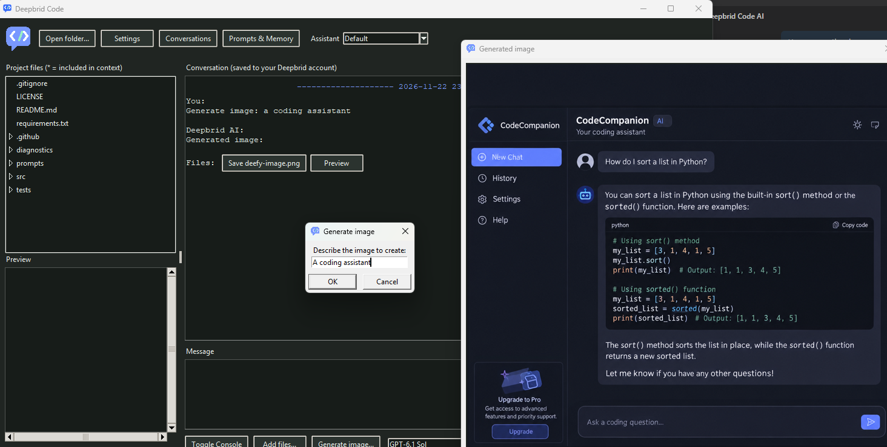

# Deepbrid Code

Deepbrid Code is a local-first Windows coding-assistant shell built with Python
and Tkinter. It can open a project folder, preview text files and images, and
prepare selected context for use in Deepbrid AI Chat.

## Run

Requires Python 3.11 or newer with Tkinter available:

```powershell
python -m pip install -r requirements.txt
python -m src.app
```

Run the tests with:

```powershell
python -m unittest discover -s tests -v
```

## Deepbrid AI API

Deepbrid Code uses Deepbrid's documented AI API directly; it does not launch or
control a browser. A Premium account and API key are required. Add the key in
**Settings** (obtain one at <https://www.deepbrid.com/devices>). The key is
stored in the operating-system credential store. Requests use the documented
Bearer authentication and are sent directly to Deepbrid.

Models and assistants are loaded from the API. Choose an assistant, model, and
optional **Web** search before sending. Selected documents and images are
uploaded through the official AI upload endpoint and attached to the message.
Responses stream into the chat; choose **Stop** to stop a response. Generated
images and files appear with save controls, and generated images can be
previewed. Use **Generate image...** to create an image directly; it uses
Deepbrid's default square format and automatic quality. Conversations are
saved to the Deepbrid account; use
**Conversations** to list, search, open, or start chats. Use **Prompts &
Memory** to manage saved prompts and memories, or insert a saved prompt into
your message. Messages, generated files, prompts, and memories are stored in
your Deepbrid account, not in the local project.

### Generate an image

With a Premium API key configured, select **Generate image...** in the bottom
toolbar and describe the image. Deepbrid Code sends the prompt to the
documented `/ai/image` endpoint using square format and automatic quality. If a
conversation is already open, the image is added there; otherwise Deepbrid
creates a conversation. When generation finishes, use **Preview** to view the
image or **Save ...** to download it to your computer. Image generation is
subject to Deepbrid's API limits.



If the key is missing or rejected, add or correct it in **Settings**. API
features require Premium and remain subject to Deepbrid's daily and rate limits.
See the [Deepbrid API documentation](https://www.deepbrid.com/api-docs) for
current model, file, and usage limits.

## Privacy and project files

Opening a folder only lists local files; it does not upload or modify them.
Common generated and dependency directories such as `.git`, `node_modules`,
`build`, and `dist` are omitted. Only files you explicitly add appear in the
included context. A leading `*` in the project tree marks files that will be
sent. Avoid selecting secrets or sensitive project content. Text
context is limited to 256 KiB per file and
1 MiB total. Image previews use the formats supported by the installed Tk
build and are limited to 20 MiB; selected images larger than that are not
attached by the app.

## Using included context

1. Open a project folder. Select a file in **Project files** to preview it.
2. Right-click a file and choose **Add selected to context**. The app attaches
   files with extensions supported by Deepbrid, including images; for other
   extensions it checks contents, includes text files such as `LICENSE`, and
   refuses unrecognized binary files. Right-click a directory or selected
   files and folders and choose **Add selected to context** to include all
   supported files and eligible text files recursively. Added files are marked
   with `*` in the project tree. Selecting or previewing a file alone does not
   include or send it.
3. Right-click a marked file or selected folder(s) and choose
   **Remove selected from context** to exclude the selected files and all
   included files beneath the selected folders. This option appears only when
   the selection contains context.
4. Enter your question in **Message** and choose **Send**, or press Enter to
   send the message and listed context. Use Ctrl+Enter to insert a newline.

Included context is kept locally in the app until you send a prompt.
Files with extensions accepted by the API are attached directly; other files
are checked by their contents and recognized text is included with its path and
contents. The API currently accepts PDF, DOCX, XLSX, PPTX, ODT, ODS, ODP,
TXT, TEXT, MD, MARKDOWN, CSV, TSV, JSON, JSONL, XML, HTML, HTM, LOG, YAML, YML,
INI, CONF, CFG, TOML, ENV, SQL, PHP, JS, MJS, CJS, TS, TSX, JSX, PY, RB, GO,
RS, JAVA, KT, KTS, SWIFT, C, H, CPP, CC, CXX, HPP, CS, M, SCALA, SH, BASH,
ZSH, PS1, BAT, CMD, R, LUA, PL, DART, VUE, SVELTE, CSS, SCSS, SASS, LESS,
TEX, SRT, VTT, GRADLE, GRAPHQL, PROTO, and images (`image/*`).

Use **Add files...** to choose supported files from outside the project. These
appear in **Additional files** with their paths (trimmed from the beginning to
keep each filename visible); no preview is shown for files added this way.
Images and manually added files are sent as attachments. Project files keep
the `*` marker in the tree.

By default, images are removed from included context after Deepbrid confirms
the message was submitted; change **Remove images from context after sending**
in **Settings** to retain them. Other context remains available for reuse.
Review marked files before sending, especially for secrets. Text included
inline has a 256 KiB per-file limit and 1 MiB total limit. Image attachments
have a 20 MiB limit; non-image attachment size limits are enforced by Deepbrid.

You can paste a screenshot from the clipboard into the **Message** box with
Ctrl+V. Clipboard screenshots and manually added images appear in the
**Additional files** section below the project tree. Pasted images appear as
thumbnails; manually added files show a shortened path. Right-click an item to
remove it. Pasting does not send anything by itself. Pasted images are held in
a temporary local folder and removed when the app closes.

The app opens at 1180x760, with the project files pane using about one quarter
of the window width and most space reserved for chat. Each prompt in the
in-memory conversation is preceded by a timestamped separator.

## Console and preferences

Use **Toggle Console** to show or hide timestamped application diagnostics and
errors in a resizable panel at the bottom of the window. The console keeps the
latest messages in memory while the app is running. File diagnostics are
disabled by default. In **Settings**, enable **Enable diagnostics file logging**
to append diagnostics to the path shown there; the default path is
`diagnostics\deepbrid-code.log` in the project folder. The checkbox and path
are independent: logging is active only when enabled and the path is nonempty.
Clearing the path disables file logging without removing the checkbox setting.

The app remembers the last project folder and reopens it next time. Preferences,
dark theme choice, and image-removal preference are stored in SQLite at
`%LOCALAPPDATA%\Deepbrid Code\settings.sqlite3`; the API key is stored separately
in the operating-system credential store. Toggle **Use dark mode** in
**Settings** to switch and save the app's appearance.
**Wrap text in file preview** is enabled by default and saved in the same
settings database. Turn it off to use the preview's horizontal scrollbar;
vertical and horizontal scrollbars are available in the preview.

The app does not impose a separate character limit on the message field. Text
context has a 256 KiB per-file limit and a 1 MiB total limit. Deepbrid's API message, attachment, and usage limits apply to all requests.
